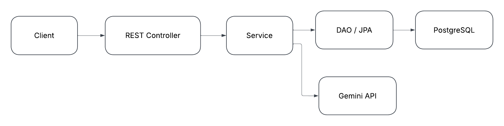
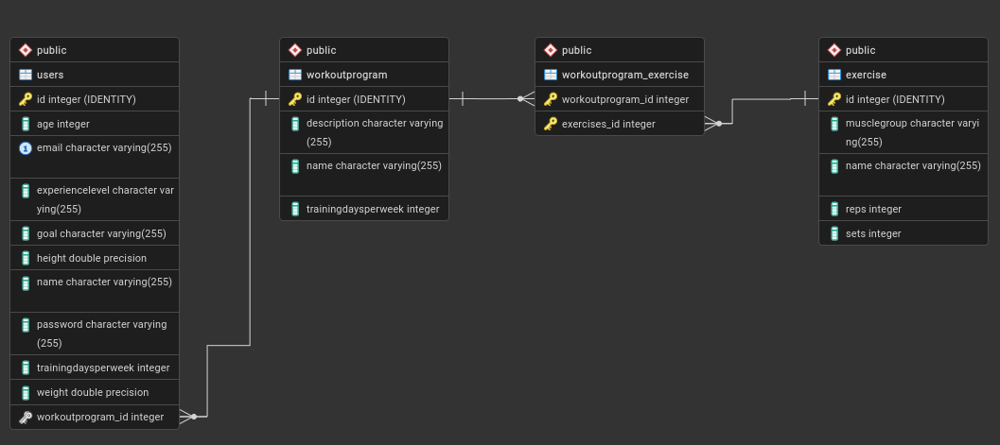

# TrainingAppExam

## Vision

TrainingAppExam is a backend REST API that helps users create a fitness profile, receive a personalized AI generated workout program and ask an AI coach fitness related questions. Users can return to their profile and workout program while the public exercise catalogue remains available without authentication.

---

## Links

Project members and portfolio websites:

Rasull Khan Hossein - [GitHub: reose7452](https://github.com/reose7452) - [Portfolio](https://reose7452.github.io/portfolio/)

Khattab Elmir - [GitHub: KhattabE](https://github.com/KhattabE) - [Portfolio](https://khattabe.github.io/portfolio-2026/)


Deployed application:

[TrainingAppExam health endpoint](https://trainingappexam.dk/api/health)

Github Repository:

[github.com/KhattabE/TrainingAppExam](https://github.com/KhattabE/TrainingAppExam)

---

# Architecture

## System Overview

The application uses a layered backend architecture.

Routes register the available HTTP endpoints.
Controllers validate requests and path parameters, select HTTP status codes and map entities to response DTOs.
Services contain authentication, password hashing, JWT handling, AI integration and workout program business logic.
DAO classes provide database access through JPA and Hibernate.
Entities represent the persisted data model.
DTOs define request and response data without exposing persistence details such as password hashes.
Configuration classes create the Hibernate EntityManagerFactory and configure the PostgreSQL connection.

Technologies used:

* Java 25
* Javalin
* JPA and Hibernate ORM with HikariCP
* PostgreSQL
* Maven
* Jackson
* Java HttpClient and the Google Gemini API
* BCrypt password hashing
* JSON Web Tokens
* JUnit, Rest Assured, Hamcrest and Testcontainers
* Docker, GitHub Actions and DigitalOcean

## Architecture Diagram




## Key Design Decisions

**Authentication and authorization**

Users register through /auth/register, where passwords are hashed with BCrypt before persistence. A successful login returns a signed JWT that expires after one hour. The token subject contains the user's normalized email, and protected routes validate the token before the controller is called. Workout program access is restricted to the user who owns the requested profile id.

**Safe user data**

A logged in user can read and update only their own profile through /api/users/me, and response DTOs never contain the password or password hash. Profile updates allow only the name and fitness fields to change, while the id, email, password and assigned workout program remain untouched. Emails are trimmed, converted to lowercase and protected by a unique database constraint.

**Read only exercise catalogue**

Exercises can be read publicly, but the API does not expose public create, update or delete operations. Exercises created as part of an AI generated workout program are stored internally by the workout service.

**AI generated data**

Gemini responses are deserialized into dedicated DTOs and validated before persistence. Program names, descriptions, exercises, muscle groups, sets and repetitions must contain usable values, and text values must fit the database limit. Invalid or unsuccessful AI responses are returned as controlled API errors.

**Transactions and replacement of workout programs**

Workout programs and their exercises are persisted in one transaction. When a user generates a replacement, the service locks the relevant data, assigns the new program and removes the old program and exercises only when they are no longer referenced. A failed operation is rolled back.

**Consistent error responses**

Javalin exception handlers convert validation, authentication, AI and unexpected errors to a shared JSON format. Expected client errors are returned without exposing internal exception details.

---

# Data Model

## ERD



## Important Entities

### User

Represents a registered user and their fitness profile.

Important fields:

- id
- name
- password containing the BCrypt hash
- unique normalized email
- age, height and weight
- experienceLevel: BEGINNER, INTERMEDIATE or ADVANCED
- trainingDaysPerWeek
- goal: MUSCLE_GAIN, STRENGTH, WEIGHT_LOSS or GENERAL_FITNESS
- optional workoutProgram

### WorkoutProgram

Represents a personalized workout program generated from a user's stored profile. It contains a name, description, number of weekly training days and a collection of exercises.

### Exercise

Represents an exercise with a name, muscle group, number of sets and number of repetitions. Valid muscle groups are CHEST, BACK, SHOULDERS, BICEPS, TRICEPS, LEGS and CORE.

---

# API Documentation

Local base URL:

```text
http://localhost:7070
```

Deployed base URL:

```text
https://trainingappexam.dk
```

## Endpoint Overview

| Method | Endpoint | Access | Success | Purpose |
|---|---|---|---|---|
| `GET` | `/api/health` | Public | `200 OK` | Confirms that the API is running |
| `POST` | `/auth/register` | Public | `201 Created` | Registers a user and stores a BCrypt password hash |
| `POST` | `/auth/login` | Public | `200 OK` | Validates credentials and returns a JWT |
| `GET` | `/api/users/me` | JWT | `200 OK` | Returns the logged-in user's safe profile DTO |
| `PUT` | `/api/users/me` | JWT | `200 OK` | Updates the logged-in user's name and fitness profile |
| `GET` | `/api/exercises` | Public | `200 OK` | Returns the exercise catalogue |
| `GET` | `/api/exercises/{id}` | Public | `200 OK` | Returns one exercise |
| `POST` | `/api/coach` | JWT | `200 OK` | Sends a fitness question to the AI coach |
| `GET` | `/api/users/{id}/workout-program` | JWT and owner | `200 OK` | Returns the user's saved workout program |
| `POST` | `/api/users/{id}/workout-program` | JWT and owner | `201 Created` | Generates, saves and assigns a new workout program |

Protected requests use this header:

```http
Authorization: Bearer <token>
```

A missing, malformed, invalid or expired token returns `401 Unauthorized`. Requesting another user's workout program returns `403 Forbidden`. Removed public user routes return `404 Not Found`, while unsupported write methods on the exercise routes return `405 Method Not Allowed`.

## Example Endpoints

### Register

```http
POST /auth/register
Content-Type: application/json
```

```json
{
  "name": "Test User",
  "email": "test@test.com",
  "password": "plain-password",
  "age": 24,
  "height": 180,
  "weight": 80,
  "experienceLevel": "BEGINNER",
  "trainingDaysPerWeek": 4,
  "goal": "MUSCLE_GAIN"
}
```

Response:

```text
201 Created
```

```json
{
  "id": 1,
  "name": "Test User",
  "email": "test@test.com",
  "age": 24,
  "height": 180.0,
  "weight": 80.0,
  "experienceLevel": "BEGINNER",
  "trainingDaysPerWeek": 4,
  "goal": "MUSCLE_GAIN",
  "workoutProgramId": null
}
```

The password is never returned. Invalid profile data returns `400 Bad Request`, and an email already in use returns `409 Conflict`.

### Login

```http
POST /auth/login
Content-Type: application/json
```

```json
{
  "email": "test@test.com",
  "password": "plain-password"
}
```

Response:

```json
{
  "token": "eyJ..."
}
```

Unknown emails and incorrect passwords both return `401 Unauthorized` with the same message.

### Get the Current User

```http
GET /api/users/me
Authorization: Bearer <token>
```

The response uses the same safe user format as registration and never contains a password field.

### Update the Current User

```http
PUT /api/users/me
Content-Type: application/json
Authorization: Bearer <token>
```

```json
{
  "name": "Updated User",
  "age": 25,
  "height": 180,
  "weight": 80,
  "experienceLevel": "INTERMEDIATE",
  "trainingDaysPerWeek": 4,
  "goal": "STRENGTH"
}
```

All seven fields shown above are required. The name is trimmed, cannot be blank and may contain at most 255 characters. Age, height and weight must be positive, height and weight must be finite numbers, age and training days must be whole numbers, training days must be between 1 and 7, and both enum values are required. Invalid or missing values return `400 Bad Request`.

The endpoint identifies the user from the JWT and returns the updated safe profile with `200 OK`:

```json
{
  "id": 1,
  "name": "Updated User",
  "email": "user@example.com",
  "age": 25,
  "height": 180.0,
  "weight": 80.0,
  "experienceLevel": "INTERMEDIATE",
  "trainingDaysPerWeek": 4,
  "goal": "STRENGTH",
  "workoutProgramId": 3
}
```

The id, email, password and assigned workout program cannot be changed through this endpoint. Sending protected or other unknown fields is rejected with 400 Bad Request.

### Generate a Workout Program

```http
POST /api/users/1/workout-program
Authorization: Bearer <token>
```

No request body is required. The id in the path must belong to the authenticated user.

Response:

```text
201 Created
```

```json
{
  "id": 1,
  "name": "Beginner Muscle Gain Program",
  "description": "A four-day program focused on building strength and muscle.",
  "trainingDaysPerWeek": 4,
  "exercises": [
    {
      "id": 1,
      "name": "Bench Press",
      "muscleGroup": "CHEST",
      "sets": 3,
      "reps": 8
    }
  ]
}
```

The saved program can be retrieved with GET /api/users/1/workout-program using the same JWT.

### Ask the AI Coach

```http
POST /api/coach
Content-Type: application/json
Authorization: Bearer <token>
```

```json
{
  "prompt": "How long should I rest between heavy sets?"
}
```

Response:

```json
{
  "answer": "For heavy strength sets, rest for approximately two to three minutes."
}
```

### Error Format

API errors use the same JSON structure:

```json
{
  "status": 400,
  "msg": "Prompt cannot be empty"
}
```

Relevant error status codes are:

| Status | Meaning |
|---|---|
| `400 Bad Request` | Request data or a path parameter is invalid |
| `401 Unauthorized` | Login credentials or JWT are missing or invalid |
| `403 Forbidden` | The authenticated user does not own the requested workout profile |
| `404 Not Found` | The requested resource or route does not exist |
| `405 Method Not Allowed` | The HTTP method is not available for the route |
| `409 Conflict` | The normalized email is already registered |
| `500 Internal Server Error` | An unexpected server-side error occurred |
| `502 Bad Gateway` | Gemini failed or returned unusable data |
| `503 Service Unavailable` | The AI request was interrupted |

---

# User Stories

- **US-1:** As a user, I want to create an account and log in securely, so I can access the application's protected features.
- **US-2:** As a user, I want to save my personal fitness information, such as age, height, weight, experience level and training goal, so the application can tailor the training to me.
- **US-3:** As a user, I want to generate a personal workout plan, so it matches my goal, experience level and desired number of training days.
- **US-4:** As a user, I want to retrieve my saved workout plan, so I can view and follow it again later.
- **US-5:** As a user, I want to ask fitness-related questions, so I can receive short and relevant training advice.
- **US-6:** As a user, I want to view an overview of available exercises, so I can find exercises that are relevant to my training.
- **US-7:** As a user, I want to view information about a specific exercise, including which muscle group it trains, so I can better understand the purpose of the exercise.
- **US-8:** As a user, I want to receive understandable error messages when I enter invalid information, so I know what to correct.
- **US-9:** As a user, I want to view and change only my own personal information, so other users cannot access my data.

---

# Development Notes

## Running Locally

Prerequisites:

- JDK 25
- Maven
- PostgreSQL
- Docker for the Testcontainers-based test suite

The default local database is named training_app, uses the PostgreSQL user postgres and connects through jdbc:postgresql://localhost:5432/. Configure the required secrets as environment variables:

```bash
export JDBC_PASSWORD="your-postgresql-password"
export JWT_SECRET="a-secret-value-containing-at-least-32-bytes"
export GEMINI_API_KEY="your-gemini-api-key"
```

CONNECTION_STR can optionally override the local connection prefix. It must end with `/` because the application appends the database name.

Build and run the application:

```bash
mvn clean package
java -jar target/app.jar
```

The server starts on port 7070. It can also be started by running app.api.Application in IntelliJ.

## Testing

Run the full test suite with Docker running:

```bash
mvn clean test
```

The suite currently contains 75 tests: 41 API tests, 20 DAO tests and 14 service tests. Database-backed tests use an isolated PostgreSQL 16 Testcontainer, and the AI service is replaced with test doubles where external calls are not required.

## Deployment

Pull requests targeting master and pushes to master run the Maven build and test suite, then build and publish the Docker image through GitHub Actions. A push to master also deploys the image to DigitalOcean over SSH. The public health endpoint must be checked manually after deployment. Production configuration is supplied through environment variables and secrets rather than committed credentials.

The deployed environment uses:

- DEPLOYED
- CONNECTION_STR
- DB_NAME
- DB_USERNAME
- JDBC_PASSWORD
- JWT_SECRET
- GEMINI_API_KEY

## Lessons Learned

* External AI output must be treated as untrusted data and validated before it reaches the database.
- JWT authentication and ownership checks solve different problems: a valid token identifies the user, while the ownership check prevents access to another user's workout program.
- Database constraints remain necessary even when the service performs validation first, especially for concurrent requests.
- Integration tests with PostgreSQL Testcontainers verify behavior against the same database type used in production.
- Deployment is not complete when a Docker container starts; the public health endpoint must also be checked to confirm that the API is reachable.
